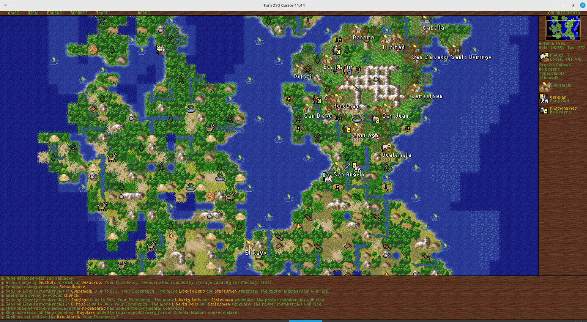
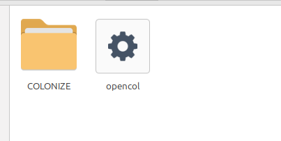

# OpenCol

> **Note:** this project was written largely by AI (Claude, Cursor and GPT,
> among others), under human direction. Disclosed per the papal recommendation
> in *Magnifica humanitas*.

OpenCol, port of **Sid Meier's Colonization** (MicroProse, 1994 DOS). Goal: same
rules, assets, saves, and inputs as the original. Fidelity bar and conflict
order: [docs/project_goals.md](docs/project_goals.md).

Version: **0.9-beta**.

Status: feature-complete. Every rule system of the DOS game is ported from
the decompiled original, and the game plays from new game through the War of
Independence. The pixel-exact dialog chrome pass is done and no bugs are open
([docs/port_plan.md](docs/port_plan.md)).

## Running the game

OpenCol **needs the files of the original DOS Colonization** (graphics,
sound, text), which are not included. Use your own legally obtained copy;
the game is still sold on GOG and Steam.

1. Get the `opencol` executable: a release package, or build it yourself
   ([docs/building.md](docs/building.md)).
2. Copy the contents of the original game folder (the one holding
   `VICEROY.EXE`) into a folder named `COLONIZE` next to the executable.

3. Run `./opencol` (`opencol.exe` on Windows).

The first run creates `settings.json` next to the executable; see
[docs/settings.md](docs/settings.md). Flags, data and save locations, music:
[docs/running.md](docs/running.md). Cheat mode (Alt-W, Alt-I, Alt-N):
[docs/cheats.md](docs/cheats.md).

## Building

See [docs/building.md](docs/building.md).

## Documentation

Status:

- [docs/architecture.md](docs/architecture.md) — present / intended code architecture
- [tests/README.md](tests/README.md) — smoke / unit / golden test layout
- [docs/port_plan.md](docs/port_plan.md) — project status, remaining work, deferred phases (agents start here)
- [docs/manual_gap.md](docs/manual_gap.md) — feature Done / Partial / Missing
- [docs/original_index.md](docs/original_index.md) — decomp / data navigation
- [docs/decomp_inventory.md](docs/decomp_inventory.md#regenerating-the-exports) — regenerating the (git-ignored) decompiled sources
- [docs/port_bugs.md](docs/port_bugs.md) — open bugs

Docs map: for conventions, jargon, fixture traps and the verification loop
see [docs/conventions.md](docs/conventions.md); for debug env vars and
`debug.logs` categories see [docs/debug_env_vars.md](docs/debug_env_vars.md).
The port-only preference file `settings.json` lives next to the executable
(see [docs/settings.md](docs/settings.md)).

## License

OpenCol code is [PolyForm Noncommercial 1.0.0](LICENSE): noncommercial use
only. The original game data is not covered and not included. Full details,
including the bundled soundfont and third-party code:
[docs/licensing.md](docs/licensing.md).
