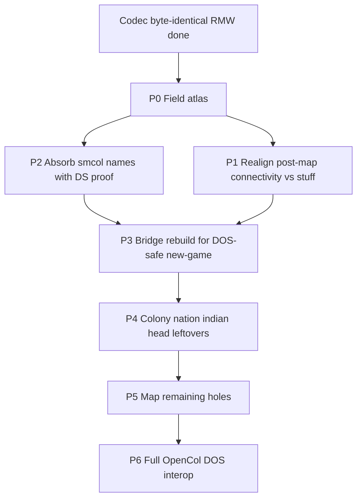

# save_format_map.md history (archived 2026-10-24)

STATUS: archived 2026-10-24 from docs/save_format_map.md — history, not a spec. The living doc is [save_format_map.md](../save_format_map.md). Lookup keys: phase ids P0-P6.

## Phased work queue (P0-P6, all Done)

| Phase | Scope | Exit criteria | Status |
|-------|--------|---------------|--------|
| **P0 — Atlas** | Inventory every opaque hole | This document exists; all `unknown*` listed | **Done** |
| **P1 — Correct the big mis-split** | Reconcile stuff vs post-map vs `FUN_75c2_0288` / `FUN_67f4_0088`; fix wrong comments | Connectivity planes named; stuff chunk table; `ColonizeCol1PostMap` | **Done** |
| **P2 — Absorb proven community names** | Rename head/nation/indian/unit/trade fields where smcol + decomp agree | Struct names match evidence; sizes unchanged; `unit_col1_save` byte-identical | **Done** |
| **P3 — Export rebuild** | Template/new-game rebuilds connectivity (+ required defaults) so DOS survives past UNITFLAG | OpenCol→DOS smoke; remaining holes documented | **Done** |
| **P4 — Deep leftovers** | Colony opaques, indian contact, stuff FA/counts, pathfinder | Cite + value ranges | **Done** |
| **P5 — Remaining holes** | Ready peels + nation/head pads + `unknown36` chunk split + `other`/head vestigial close | Every byte named or closed save-only/vestigial + DS | **Done** |
| **P6 — OpenCol→DOS interop** | Mask density, blank census, colony capture fill, vis_mask, AI blob discipline | Template export smoke; fixture RMW identical | **Done** |

