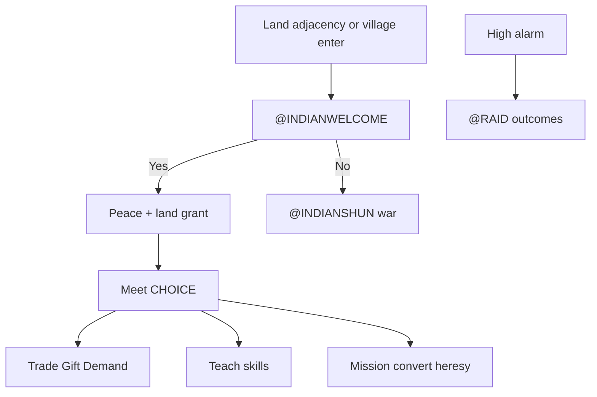

# Indians

Hub for native nations in Sid Meier's Colonization (1994): graphics, unit and
settlement types, tribe differentiation, alarm, and European contact. Deep FUN
checklists stay in annotated AI extracts — this file is the topic map.

Authority order: [project_goals.md](project_goals.md) (decomp / NAMES → manual →
fandom). Feature checklist: [manual_gap.md](manual_gap.md) §Indians. Port FUN
status: [port_plan.md](port_plan.md).

## Sources

| Source | Role |
|--------|------|
| [`COLONIZE/NAMES.TXT`](../COLONIZE/NAMES.TXT) `@TRIBES` / `@LEVELS` / `@UNIT` / `@ATTITUDE` / `@ACTIONS` / `@JOB` | Shipped catalogs (tech, specialty, icons, attitude labels) |
| [`COLONIZE/TRIBE.TXT`](../COLONIZE/TRIBE.TXT) | AMERICA village seed coordinates |
| [`COLONIZE/GAME.TXT`](../COLONIZE/GAME.TXT) `@INDIAN*` / `@RAID*` / `@MISSION*` | Dialog tags |
| `FUN_4d56_*` / `FUN_6a09_*` / `FUN_5bfb_*` / `FUN_4cc6_*` / `FUN_5fef_*` in [`viceroy_unpacked.c`](../original_sources_decompiled/viceroy_unpacked.c) | **Authoritative** nation turn, placement, meet, relations, raid loot |
| [`indian_contact.md`](../original_sources_annotated/ai/indian_contact.md) (+ trade / settlement / raid siblings) | Layer D contact / alarm / meet map |
| [`Colonization.pdf`](../COLONIZE/Colonization.pdf) pp.67–78 | Manual Natives prose |
| [fandom_col1994.md](fandom_col1994.md) §Natives | Tier-3 — Unverified until reconciled |
| Port [`ai_contact.c`](../src/core/ai_contact.c), [`ai.c`](../src/core/ai.c), [`ai_diplo.c`](../src/core/ai_diplo.c), [`map_panel.c`](../src/core/map_panel.c), [`col1_save.h`](../src/core/col1_save.h) | Wired stand-ins; PARK comments name gaps |

Col1 layouts: `ColonizeCol1Tribe` / `ColonizeCol1Indian` — field atlas in
[save_format_map.md](save_format_map.md). Nation ids **4–11** = `@TRIBES` order
(Inca…Tupi); Euro ids **0–3**.

---

## Graphics

| Asset | Use |
|-------|-----|
| `ICONS.SS` **#10–13** | Village markers by `indian.tech` (tipis / adobe / pyramid / city). `MAP_PANEL_TRIBE_ICON_BASE` 10 in [`map_panel.c`](../src/core/map_panel.c); sidebar Locat uses the same tech icon |
| `ICONS.SS` **109–112** | Unit blit indices from `@UNIT` icons **110–113** (1-based → 0-based on load) — Braves / Armed / Mtd. Braves / Mtd. Warriors |
| Minimap | Tribe dots palette **12** ([assets.md](assets.md)) |
| `REPORT9.PIK` | F9 Indian Adviser |
| `IND0A0.SS`…`IND7A3.SS` | Shipped 8 nations × 4 alarm tiers (`FUN_15dc_00a2` bands of `alarm_by_player`). **Loaded 2026-08-29** as the chief portrait beside every tribe-addressed contact popup (`ai_popup.c`, `FUN_6f74_0042` — DS:0x1f77 holds the literal `"IND0A0"`, DOS adds the tribe to byte 3 and the quartile to byte 5, so the name is patched in place, never formatted). **Placement made DOS-literal 2026-09-07e** (`FUN_6f74_14c6`, OVL24 `0x17a0..0x189c`): span = `dialog_w + sprite_w + 6` clamped to 320, `span_x = 160 − span_w/2`; sprite LEFT for tribes 0/3/5/7 and the King, RIGHT otherwise; the DOS gutter word starts at **−3** (not 0) and only becomes `span_w − 323` on clamp, so the left arm puts the dialog at `span_x + sprite_w + 6` and the right arm the sprite at `span_x + dialog_w + 3`; sprite top = `100 − (sprite_h + 3)/2`. Sheet dims are the loaded sprite's (DOS `+0x4a/+0x4c` is a runtime field — the `.SS` header carries no bounding box); `KING.SS` and `KING2.SS` are both 79×161, so the port's base/overlay max is a no-op |

Draw order on the main map: colonies → villages → units so stacked units stay
visible ([assets.md](assets.md)).

**Capital marker:** Col1 `tribe.state.capital` bit drives growth, homeland
radius, surrender, and Cortes `rich_capital`. Fandom “starburst” on capitals is
**Unverified vs DOS** as a separate sprite — OpenCol blits the same tech icon
`#10–13` for capital and satellite villages.

Euro colony contrast: settlement art **#0–3** (none / stockade / fort /
fortress).

---

## Unit types

From `NAMES.TXT` `@UNIT` (Indian block). Comment columns: icon, movement,
attack, combat, …

| Name | Icon (1-based) | Moves | Attack | Combat | Notes |
|------|---------------:|------:|-------:|-------:|-------|
| Braves | 110 | 1 | 1 | 1 | Base; Viceroy type **19** (`VICEROY_UNIT_TYPE_BRAVE`) |
| Armed Braves | 111 | 1 | 2 | 2 | Muskets |
| Mtd. Braves | 112 | 4 | 2 | 2 | Horses |
| Mtd. Warriors | 113 | 4 | 3 | 3 | Horses + muskets |

Nation stocks `indian.muskets` / `horse_herds` / `horse_breeding` feed equipment
upgrades (Col1; see save atlas). Quiet Brave AI: `FUN_4d56_14fe` → OpenCol
`ai_native_nation_pulse` (history: port_plan.md T1.23). Brave MP uses
terrain table ×3 (same scale note as unit orders).

**2026-09-08 — `01e2`/`14fe` audit closed.** Both re-read off the raw asm
(Ghidra mis-resolves every `PUSH CS; CALL` in overlay `0x0C` into `CODE_112`;
the truth is the 15-entry JMPF stub table at `4d56:4c22..4c6c`,
`turn/mid_pass_indian_rank.md`).

- `FUN_4d56_01e2` (`4d56:01e2..0219`) is **not** act plumbing: it is the
  tribe-wipe helper — `nation = arg + 4`, descending walk of the tribe array
  (`DS:0x54ec`, stride `0x12`, count `DS:0x539a`), `FUN_4d56_00e0(i)` for every
  row whose `+2` nation byte matches. It is **dead code** in the shipped EXE
  (absent from the export stub table, no near CALL/JMP in segment `4d56`, no
  bank record targets it), so there is nothing to port. `col1_kill_indian_nation`
  (`ai.c`) is an OpenCol invention with a wider blast radius; `col1_destroy_tribe_at`
  (`units.c`) is the real `00e0` port.
- `FUN_4d56_14fe` (`4d56:14fe..152c`) is **faithful** and is three branches
  only: `dir = FUN_4d56_021a(unit)`; `dir != 8` → `FUN_2a1f_0150` (→ `465b`
  step); else `FUN_281f_0934` (exhaust MP — the guarding `dir >= 0` test is
  dead). `021a` already exhausts on its own `dir == 8` exit (`021a:14e6`), so
  the OpenCol `moves = max_mp` covers both writes.
  The `465b` step itself is not a plain move when the destination is foreign
  (`local_4` = stack-head nation, else settlement owner, != Brave): DOS
  exhausts (< 3 MP left) or attacks via `1b0e`, and never lands the Brave on
  the tile. `units_tile_head_id_at` selects the latest tile arrival, including
  Col1-imported chains, as `FUN_281f_07e0` does (#848).
  `ai_native_brave_step` keeps that end state (in place, exhausted)
  and, since 2026-09-23 (bugs.md #822), resolves the attack on the ≥ 3-thirds
  limb through `units_resolve_land_combat` — the same `1b0e` resolver every
  other attacker uses, defender picked by `FUN_5fef_0000`
  (`units_best_defender_at`), with the colony-raid handoff `units.c` takes
  from `ai_contact_raid.c` on the loser limb. Two deliberate limits: the
  defender must be a European (the port models no tribe-vs-tribe combat), and
  an undefended colony tile keeps the exhaust-only end state. Before
  2026-09-21 the port walked the Brave INTO Euro colonies (bugs.md #553).
- The residue behind the old "partial (T2 quiet)" label is the **callee**:
  `FUN_4d56_021a` (`4d56:021a..14fd`, 4836 bytes, one function) — the Indian
  unit decision routine Ghidra emitted as raw `??` bytes, reached from `14fe`
  via stub `4c3b`. **Correction 2026-09-15:** it does NOT call the `521d` scorer — `291f:012c`
  (`021a:1182`) is `FUN_7a65_0008`, the DEBUG.TXT "Indian AI movement" score
  plotter (DS:0x894 bit 1), separate from GAME.TXT "Show Indian Moves";
  021a
  carries its own dir loop, now ported as `ai_native_pick_dir_021a`
  (`ai_native_021a.c`). The score plotter is now called after the final
  `RNG(1,5)` and zero clamp for each accepted direction; the UI draws the
  numeric scores on tiles in the current viewport when the debug flag is active
  (#848).
  Decoded there and, since 2026-09-23, **all four
  ported and audited term-by-term** (bugs.md #850): homeless-unit despawn
  (`021a:0337`, bad `+0x314a` → `FUN_281f_0808` + return −1) —
  `ai_brave.c:455`, with one recorded deviation, DOS returns −1 into a
  use-after-free in `14fe` and the port STOPs the Brave instead; the
  unconditional `facing` write including the stay value 8 (`021a:11b9` →
  `+0x314f`) — `ai_brave.c:508` (`last_dir` is the full signed byte, saved as
  facing + facing_pad; bugs.md #846, #1046); the `orders` cower latch on stay (5 or 6 → 6, anything else → 5) and
  0 on move (`021a:11cd-11ea`/`1272`) — `ai_brave.c`, unconditional since
  bugs.md #1093 deleted the raid escort that was the only source of an
  OpenCol-only Brave order (the old #826 guard); and the **in-field arm/mount upgrade**
  (`021a:11ef..126c`) — `ai_brave.c:531`. The upgrade: a Brave that stays on its own
  tribe's tile gets type `0x13`/`0x15` → +1 when `indian+7` muskets > 0 (musket
  spent on `rng_range(0, difficulty) == 0`) and += 2 when `indian+0x0a`
  horse_breeding ≥ `0x19` and max MP ≤ 3 (`-= 0x19`). This is separate from the
  spawn-time arming already ported in `ai_indian_152e_village_growth`
  (thresholds `0x31`/`0x32` there) and is the DOS source for the "nation stocks
  feed equipment upgrades" line above.
- Caller-side (`1816` §7/§8) deltas, report-only because
  `tests/golden/test_ai_turns.c:195` compares Brave `moves`/`col1_counter16`: DOS
  increments the act counter `+0x315a` (= `col1_counter16`) once per **attempt**
  before calling `14fe` (`4d56:1af3`), caps at `0x14` then exhausts and zeroes
  it; the OpenCol pulse does the same — it bumps `col1_counter16` **before** the
  `021a` pick, with the same `> 0x14` → exhaust + zero cap
  (`ai_brave.c:438-452`), corrected 2026-09-23 (bugs.md #850). Gate is
  `FUN_281f_097a` → `FUN_1427_13b0` (AX-register arg): index in range, `+0x3144`
  ≥ 0, nation nibble == `DS:0x5394`, `(+0x3148 & 0x80) == 0 || type == 0x0b`,
  and `+0x3149` spent < max MP.

Related catalogs:

| Catalog | Indian-relevant entries |
|---------|-------------------------|
| `@JOB` | **Convert** (`Indian Converts`) — missionary / Sepulveda / Las Casas paths |
| `@ORDERS` | **Live In Village** |
| `@ACTIONS` | Trade With Village, Enter Hostile Village, Establish Mission, Denounce Heresy, Live Among The Natives, Speak With Chief, Incite Indians, Demand Tribute, Attack Village |

Euro units that drive contact: Scout, Pioneer, Soldier, Dragoon, Artillery,
Missionary / Jesuit (the missionary acts at a village through the
`FUN_4d56_4528` switch — human @ACTIONS rows, AI non-human branch case 3 —
never by standing next to one; the old adjacency "mission pulse" was invented
and was deleted 2026-09-22, bugs.md #557).

---

## Settlement types

### Tech class (`@LEVELS` ↔ `indian.tech`)

| Tech | Level name | Settlement word | Map icon |
|-----:|------------|-----------------|----------|
| 0 | Semi-Nomadic | Camp | `#10` tipis |
| 1 | Agrarian | Village | `#11` adobe |
| 2 | Advanced | City | `#12` pyramid |
| 3 | Civilized | City | `#13` city |

`@LEVELS` also lists `<Any>, Capital, Capitals` — capital is the **state bit**,
not a fifth tech.

### Nations (`@TRIBES`)

| Nation id | Plural / short | Specialty good | Tech | UI color |
|----------:|----------------|----------------|-----:|---------:|
| 4 | Incas / Inca | Jewelled Relics | 3 | 15 |
| 5 | Aztecs / Aztec | Gold Bars | 2 | 149 |
| 6 | Arawaks / Arawak | Bone Jewelry | 1 | 54 |
| 7 | Iroquois / Iroquois | Wood Carvings | 1 | 11 |
| 8 | Cherokee / Cherokee | Turquoise | 1 | 67 |
| 9 | Apache / Apache | Beads | 0 | 111 |
| 10 | Sioux / Sioux | Beads | 0 | 117 |
| 11 | Tupi / Tupi | Gems | 0 | 71 |

`NAMES.TXT` also lists extra tribe name pairs (Maya, Huron, …) after the eight
playable nations — cosmetic / scenario pool, not additional `indian[8]` slots.

### Placement and growth

| Mode | Source |
|------|--------|
| AMERICA | [`TRIBE.TXT`](../COLONIZE/TRIBE.TXT) `@INCA`…`@TUPI` coordinates |
| NEW WORLD | Procedural `FUN_6a09_0006` → `ai_place_tribes_procedural` (capitals then satellites) |

`FUN_1427_02ca` (raw 7497-7506) marks a newly spawned Brave's tile occupied,
but leaves its owner nibble at `0xf` if `FUN_137f_0598` identifies a rumour
there. The first seed-100 Inca Brave spawns on such a tile at (10,25); `021a`
then skips its stay direction. The port restores that nibble after its generic
spawn occupancy update, and no longer adds six fitted Inca RNG draws after
the first step (#849). The seed-100 golden now tests with occupancy bound.

**NEW WORLD-only Silver bid bonus (wired 2026-08-24).** After every capital
and satellite tribe is placed, `FUN_6a09_0006`'s own tail re-walks each tribe
and scans the 5×5 window centered on its own tile for terrain class `0x1b`,
adding that nation's `tech` to `indian.hill_silver_bid_bonus` per hit (read
side already fed the tribe's Silver bid — see `ai_contact.c`). Class `0x1b`
is **Mountains**, not Hills — the field's original name was a decode-era
mislabel (raw `.asm` of `FUN_13e4_000e` and `map.c`'s independent
MAPEDIT-derived convention agree: `0x1b`=Mountains, `0x1c`=Hills); kept the
existing field name (no rename of a live field) and fixed the comments +
the write side instead. AMERICA-mode tribes never get this bonus — it's
specific to the NEW WORLD/procedural placement function, not the
TRIBE.TXT path. Full trace: `col1_save.h`'s `hill_silver_bid_bonus` comment
and `ai.c`'s `ai_place_tribes_procedural`/`ai_decoded_type`.

Initial village population = **`3 + 2*tech`**. Growth `FUN_4d56_152e` /
`ai_grow_villages`: accumulates on **capitals only** — satellite villages never
grow (real DOS TURN1/TURN2 seed-100 show their `growth_accum` frozen at 0);
`growth_accum += population` each turn, and it spends at accum **> 19**.

There is **no flat pop cap of 15**. The ceiling is `FUN_4d56_0000` /
`ai_indian_152e_worth_cap`, a per-tribe "worth" from the tribe's tech tier:
**`2*tech + 3`** for a regular village, **`3*tech + 4`** for a capital
(`worth = tech*2+3; if (capital) worth = tech + worth + 1`), truncated
through a byte before the compare as DOS does. Growth fires while
`population < worth`. Since only capitals grow, the capital arm is the one
that is ever exercised — and `3*tech+4 > 2*tech+3 = ` the founding pop, so a
fresh capital always has room to grow. Empty-tile Attack (`FUN_5fef_1b0e`): temp Brave fight from the
**adjacent** tile (attacker stays put), then **`population--`**, or **destroy**
when `population < 2` (so a pop-3 camp survives two successful raids). Map Braves
that patrol nearby are separate — killing one does not burn the dwelling.

Homeland (tribal-land) radius: the tribe's tech tier — `FUN_15dc_006a`:
tech 0/1 → **1**, tech 2 (Aztec) → **2**, tech 3 (Inca) → **3**, nearest
village on the **same continent** (`FUN_4cc6_0356` / the 5x5 native cache).
**Re-verified 2026-09-04** (bugs.md "Indian land should only be a 1-tile
radius"): `FUN_15dc_006a(nation)` reads `nation*0x4e + 0x5ad8` (tech) and
returns 1 / 1 / 2 / 3; all three call sites test `dist <= radius`
(`viceroy_unpacked.c:12850` colony tile cache, `viceroy_unpacked_2.c:75564`
and `:75663` the `@INDIANLAND` found/clear gate). 1 tile is right for six of
the eight nations — only Aztec (2) and Inca (3) reach further. `colony.c`
`colonies_indian_land_radius` matches; **not a defect**.
Was the manual's "capital 2" rule until 2026-08-28 (`colony.c`
`colonies_tile_indian_homeland`).

**Which tiles the colony screen may mark (2026-09-04, bugs.md #366).** The
5x5 table `FUN_15eb_26e4` builds is not just "village within radius":

* `FUN_13e4_0074(tile)` clears the slot whenever the terrain index is **25 or
  26** (Ocean / Sea Lane) — no totem ever sits on water, however close the
  village is. Arctic (24) is *not* excluded.
* The continent filter passed to `FUN_4cc6_0356` is read **once, at the colony
  tile** (`uVar2 = FUN_137f_02a0(colony.x, colony.y)`, hoisted above the loop),
  not per cell. A village on a neighbouring island can therefore never claim a
  cell of this colony's ring. The unit-side gates (`FUN_479b_043b` / `_0687`,
  clear-forest and road) read it at their own tile instead — different call
  site, different origin.
* The slot is also cleared for a worked field tile (`FUN_15eb_06a6`), for
  already-purchased land (`FUN_15eb_0620`, mask bit 0x10), for an unmet tribe
  (`FUN_15b3_0004 & 0x20`) and, wholesale, for Peter Minuit
  (`FUN_15eb_3960(nation, 2)`).

Port: `colonies_indian_claim_tribe_from_w(w, nation, origin_x, origin_y, x, y)`
(`colony.c`); the old origin==tile wrapper `colonies_indian_claim_tribe` is gone.

Founding / clearing / road-building on
such a tile at PEACE with the owner raises the DOS `@INDIANLAND` /
`@INDIANFOREST` / `@INDIANROAD` CHOICE (respect / offer gold / take it);
outside that dialog nothing is charged — see
[indian_actions_menu.md](../original_sources_annotated/ai/indian_actions_menu.md).

**Teach skill is always free** (no gold changes hands either way — corrected
2026-08-13, was never wired to charge). Non-capital villages teach **one**
skill to **one** colonist, **total across all Euro nations** — once any
nation's colonist learns there, the offer is gone for everyone. The tribe's
**capital** is exempt from that one-shot and teaches unlimited colonists.
`ai_contact_learnstay_apply` (`ai_contact_actions.c`) implements this via
`tribe.state.learned` (one-shot, shared — matches "total across all
nations") gated by `!tribe.state.capital` (capital bypasses the gate). (The
older `ai_contact_teach_skill` village-adjacency pulse was retired, bugs.md
#573 — see the RETIRED note in `ai_contact.c`.)

**Human teach is the "Live Among The Natives" menu action** (2026-08-28,
`ai_contact_live_among_natives` = `thunk_FUN_1000_a618`): `@LEARNSTAY`
Yes/No, `@LEARNSLOW` random refusal in the 25..49 alarm quartile,
`@LEARNMAD` (+3 alarm) at quartile ≥ 2, `@TEACHCONVERT`, `@LEARNMASTER`,
`@LEARNCRIMINAL`, `@LEARNALREADY`. The taught skill is DOS's weighted draw
over the 2154 bid table (tech-trimmed; Fur Trapper → Seasoned Scout on
`(x+y)%3==0`; Farmer → Fisherman by an ocean-ring roll), seeded from the
village position so each village always offers the same skill. The
per-turn auto-teach pulse now runs for AI nations only.

Key tribe fields: `x`/`y`, `nation_id`, `state.{capital,learned,scouted,…}`,
`population`, `mission` (`0xff` none; low nibble Euro id; bit `0x10` Jesuit),
`last_bought` / `last_sold`, `alarm[4]`.

---

## Tribe “personality”

There is **no dedicated personality byte** in Col1 or NAMES. Differentiation is:

| Mechanism | Effect |
|-----------|--------|
| **`indian.tech`** | Settlement art class, initial pop, meet-scoring weight (`FUN_4d56_2154`) |
| **Specialty good** (`@TRIBES` field 3) | Trade chrome flavor (`Jewelled Relics` … `Gems`) — not the teach profession |
| **UI color** | Tribe tint from `@TRIBES` |
| **Teach outdoor map** | RETIRED (bugs.md #573): DOS draws the village skill from the per-tech bid table (`overlays.c:77658-77835`, `ai_contact_actions.c` teach arms), seeded per village; there is no nation→default table or `last_sold` override. |
| **Runtime attitude** | Alarm / friction → `@ATTITUDE` labels (Content … War) |

Fandom “Aztec warlike / Inca peaceful” ([fandom_col1994.md](fandom_col1994.md))
is **Unverified vs DOS**. Observed nation bias in code/docs is tech + Spanish
conquest / French cooperation hooks, not a named personality enum.

---

## Alarm

Moved to [indian_alarm.md](indian_alarm.md): what moves the nation-level number,
thresholds, the two layers, gameplay bands, escalation and pacify.

---

## Interactions with Europeans

Deep path map: [indian_contact.md](../original_sources_annotated/ai/indian_contact.md).
Popup tags: [popups.md](popups.md). Diplo matrix: [`euro_diplo.md`](../original_sources_annotated/ai/euro_diplo.md),
[`ai_diplo.c`](../src/core/ai_diplo.c).

### First contact (`FUN_5bfb_022e` / `0182`)

- Unmet **land** unit next to a village (ships skipped) → `@INDIANWELCOME` Yes/No.
- **Yes** → peace bit, clear alarm/friction toward Euro, OK `@INDIANPEACE` /
  `@INDIANCOME`; thin land grant stamps purchased + owner on the occupied tile.
  Ends without Meet CHOICE.
- **No** → war / hostility, alarm ≥80, `@INDIANSHUN`.

### Meet menu (already met)

Village tile entry: Trade / Gift / Demand / Teach / Leave
(`ai_contact_try_village_meet_unit_at`, from `game_loop_orders.c`; the
`ai_contact_try_village_meet` / `_unit` argument-defaulting forms are
test-only seams). The greeting body is the `@VILLAGE*` band
section picked from alarm (`VILLAGEHAPPY/SAVAGE/MEDIUM/BAD/WAR`, built in DOS
from the DS `"VILLAGE"` stem + suffix). `@INDIANHELLO1` / `HELLO2` are **dead
GAME.TXT**: 2026-09-16 scan of `VICEROY.EXE` DS finds no `INDIANHELLO` tag
string at all, so DOS never shows them. Deep bargain matrix `FUN_4d56_2820` is **ported**, not parked (stale
row corrected 2026-09-07f) — hold pick, throttle
table `k_2820_throttle` (`:5066`), want-sort (`:5050`), haggle, gift,
post-sale buy. `ai_contact.c` was split 2026-09-23; the 2820 machinery now
lives in `ai_contact_trade.c` (village trade economics) and
`ai_contact_actions.c` (`ai_contact_2820_begin` shell + menu), seams in
`ai_contact_internal.h`. Verification rewrite 2026-08-29,
[`indian_trade_2820.md`](../original_sources_annotated/ai/indian_trade_2820.md).

**Interacting with a village forfeits the unit's remaining MP** (2026-09-04).
`FUN_4d56_4528`'s common tail (`viceroy_overlays.asm` `OVL13::004c0a`) calls
`FUN_1000_8b24` = `FUN_281f_0934` → `FUN_1427_155e` (`spent := max MP`)
whenever the dispatch returns code **1** — Trade, Denounce Heresy, Live Among
The Natives, Speak With Chief, Incite, Demand Tribute and plain Leave. Only
**Attack Village** (code 0; the move/combat spends MP itself) and **Establish
Mission** (code 2) keep their movement. Full case table + the retraction of
the old "8b24 is a harmless stat-cache refresh" reading:
[`indian_settlement_4528.md`](../original_sources_annotated/ai/indian_settlement_4528.md)
§2026-09-04. Ported in `ai_contact_apply_popup_result`.

### Indian-initiated visit (`FUN_5bfb_022e`, the Brave's own move)

One encounter picks a half via `bVar6` (mood roll
`rng(1,0x148) ≥ max(0, alarm−0x19)*4 + village alarm word`, plus
`alarm ≤ 0x4a` overall and `alarm ≤ 0x31` for the generous half):

| Half | Arms |
|------|------|
| Generous (`LAB_5bfb_096c`) | `@INDIANGIVEFOOD` (village food surplus `bid[0] > ask[0]` **and** colony food ≤ 25 → top up to 75) / `@INDIANGIVESTUFF` (gift the good the village values most that still fits) — and, on a mission-owned village, `@INDIANSCONVERT` first on a `tech+2` (×2 Jesuit) vs `rng(0,0xf)` roll |
| Demanding (`LAB_5bfb_0def`) | `@INDIANBEGFOOD` (`ask[0] > bid[0]` **and** colony food > 74) / tribute from an adjacent unit |

The two halves are **not** symmetrically exclusive (bugs.md #863). The
`@INDIANBEGFOOD` block at raw 87650-87698 sits *before* the `bVar6` fork and
runs on its own conditions; when the colony **concedes** the beg (`local_c ==
2`) DOS sets `bVar7 = true`, rolls `rand(0, difficulty)` (non-zero ends the
visit) and otherwise forces `bVar6 = true` — so the conceded beg falls through
into the generous half of the **same** visit. `bVar7` then adds a third term to
the `LAB_5bfb_096c` fork (`bid[0] <= ask[0] || bVar7 || 25 < colony food` →
`@INDIANGIVESTUFF`), which stops the village handing back the food it just
took. In the port `ai_contact_apply_beg_food`'s accept arm publishes that
`bVar6`/`bVar7` pair through `ai_contact_s_visit_mood` and re-enters
`ai_contact_try_village_gifts` itself.

The gift half stamps `contact_state[euro] = 2` and **zeroes that village's
alarm word** toward the visited nation. `contact_state` (`ColonizeCol1Indian
+0x2e`, persisted) is a sticky per-(tribe nation, Euro) latch and the two
halves read it: **2 permanently disables the demand/beg arm**, **1 permanently
disables the gift arm** (`local_10`). `ai_contact_try_village_gifts` (returns 1
when it gifted, so the step site skips the beg arm) /
`ai_contact_try_village_beg_food`. The generous half was missing entirely until
2026-09-04 — the only peaceful visitor the player ever saw was a beggar.
Whether a village begs or gifts is a **per-village** 2154 terrain/population
question (DOS binds the visiting Brave's own home settlement, `unit+0x314a`),
not a tribe personality: an Aztec village on food-poor terrain begs, one with a
surplus brings food.

**Trigger (rewritten 2026-09-23, bugs.md #824/#850).** DOS runs `022e` from
`FUN_465b`'s move tail (`FUN_281f_0984` → `FUN_5bfb_3180`), once per Brave
*step*, for the neighbour tile the encounter scan found; a Brave parked beside
a colony raises nothing. The port now does the same: `ai_native_brave_step`'s
commit tail calls `ai_native_step_first_contact` (`ai_brave.c`), which runs the
mood roll (`ai_contact_visit_step_roll`, raw 96745-96760) **and** then the
matching half — `ai_contact_try_village_gifts`, else
`ai_contact_try_village_beg_food` — for the Brave that just stepped, at most
one resolved encounter per nation per pass (DOS's `aiStack_20[nation]`).
Retired with that move: the 8-turn per-nation throttle (already gone
2026-09-10, it was an invention) and the gift half's "no popup queue →
decline" bail. `ai_contact_brave_walked_up_to` survives inside the two arms,
no longer as a reconstruction of the trigger but as the selector that picks
the Brave that is mid-step out of the nation's units (a loitering Brave still
raises nothing); the post-pulse village-trade/reparations arm still uses it as
the reconstruction it always was.

There is **no passive teach arm** in `022e` — retired 2026-09-04. The port's
old per-turn adjacency pulse invented "The %s teach outdoor skills." (no such
GAME.TXT tag) and fired `@LEARNMAD` / `@LEARNCRIMINAL` refusals at any
colonist a Brave wandered past. Teaching is reached only through the
deliberate **Live Among The Natives** `@ACTIONS` row.

### Missions and Founding Fathers

| Hook | Effect (port / sources) |
|------|-------------------------|
| Missionary / Jesuit | Sets `tribe.mission` (+ bit 0x10 when prof 0x18 or Brebeuf); no alarm-band gate, no crosses (audit 2026-09-22). Reached from the village only: human @ACTIONS Establish/Denounce, AI through `ai_contact_ai_missionary_village` (`4528` non-human switch case 3 → incite / establish / denounce). There is no adjacency convert pulse and no missionary flee arm (both deleted 2026-09-22, bugs.md #557) |
| Foreign mission | Denounce = weighted roll (`a594`); DOS Jesuit test is `prof == 3` (typo, dead) — bugs.md #558 |
| Las Casas | Existing Converts → free colonists on elect |
| Sepulveda | Higher convert-join odds on settlement fallout |
| Cortes | Conquest treasure **bonus and guaranteed payout**, not a prerequisite — any conqueror can find treasure, and at difficulty 2+ always does (bugs.md #381); capital = `rich_capital` |
| Minuit | Indians no longer demand land payment |
| Pocahontas | Reset + half future alarm |

Incite / WARPATH gold **Done both modes, byte-faithful** (2026-09-06
audit; first ported thin 2026-08-13) — `FUN_4d56_417e` as a village-meet
CHOICE (`ai_contact_apply_incite`) plus the AI Mode-2 auto-incite
(`ai_contact_ai_incite_human`, `4528` tail case 7, reached from
`ai_contact_ai_missionary_village` — the AI missionary's village arm). 2026-09-06 fixes: price multiplier is the raw
`0x5b1c` **alarm** value +75 (was inverted via `ai_diplo_indian_relation`);
the relation push is `281f_0d6c` → `FUN_4cc6_00f2` = **+100 alarm slam**
(French-target/Pocahontas-halved, clamped at 100 — was a flat +10
placeholder); DOS refusal gates wired (`@NOCONTACT` 0x16b7 tribe hasn't
met target, `@UNFORTUNATE` 0x16d0 treasury, `@ALREADYSMITE` 0x16dc tribe
already in the war band with target) and the shared `@INDIANWARFARE`
(0x16e9) War Council announce — the annotation's old "0x16e9 =
WARPATH2" was off by a tag (0x16c1 is WARPATH2, the pay confirm).
2026-09-16: the dialog is now the DOS **two-step** — `@INDIANWARPATH`
(0x16a9) target menu whose rows are plain nation names and are *not* filtered
by affordability, then the `@INDIANWARPATH2` pay confirm quoting the price
("Pay …" / "Never mind."); the treasury test happens after that confirm, as
`@UNFORTUNATE`. Both bodies now come from GAME.TXT.
Mode-1 target set = the other Euros minus `head.crown_nation_id`; once
`game_options.woi` is set the target is fixed to the Crown (DOS
`0x5382` bit0 — the WoI latch, not an "AMERICA scenario" flag). See
[`indian_incite_417e.md`](../original_sources_annotated/ai/indian_incite_417e.md).

### Raids and combat fallout

`FUN_5fef_0f14` rolls the kind, DOS-literal since 2026-09-23 (bugs.md
#827-#833): walls roll → `rand(1,4)` = **four** kinds only (1 goods
`@RAIDSTORES`, 2 building `@RAIDBURN`, 3 ship `@RAIDSHIP`, 4 gold
`@RAIDGOLD`) → a **fortification**-gated demote chain (`FUN_281f_09fc(n)` is
the colony's building-bit test: Fort, Stockade, Fortress) plus an early-turn
grace on Discoverer/Explorer. There is no scalp kind (`@RAIDSCALP` is dead
GAME.TXT text) and no "wreak" kind — `@RAIDWREAK` (0x1b8a) is the third-party
"Spies report" bulletin the human gets when the raided colony is somebody
else's. Alarm never gates the kind; it gates the pulse's targeting. Colony
encroachment and ambush chrome thin-Done. Capital destroy →
`ai_diplo_indian_capital_surrender` (reset hostility once; no new capital).
Loot detail: [indian_raid_outcomes.md](../original_sources_annotated/ai/indian_raid_outcomes.md),
[indian_raid_loot.md](../original_sources_annotated/ai/indian_raid_loot.md).
Odds / resolve: [combat.md](combat.md).

### Ship → village

Not landfall: `@DONTKNOWSHIPS` / `@MADATSHIPS` ([move_enter.md](move_enter.md);
settlement head `FUN_4d56_4528` warn→Attack Done thin; `2820` ported —
see `ai_contact_trade.c` / `ai_contact_actions.c` above).

### Nation turn shell

`FUN_4d56_1816` / `ai_indian_nation_turn`: reseed → alarm prelude → clamp →
village growth → relation tick → quiet Brave pulse → meet/trade/raid arms.

---

Port development snapshots (historical): [archive/indians_port_snapshots.md](archive/indians_port_snapshots.md)
