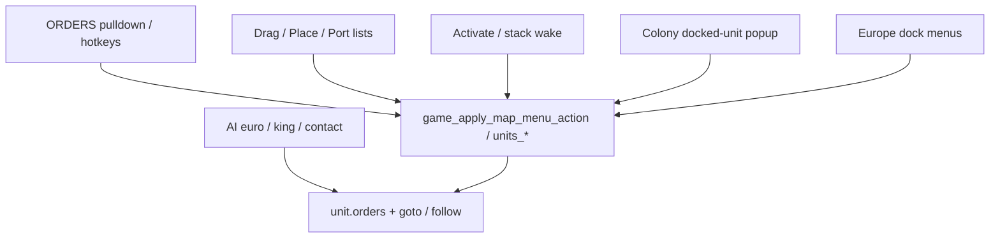
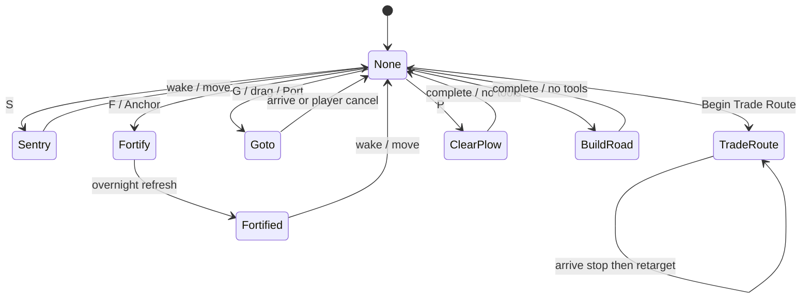

# Unit order mechanics

Player-facing rules for issuing and resolving unit orders: what should happen
in which context. Authority: manual pp. 23–29; `NAMES.TXT` `@ORDERS`;
`MENU.TXT` `@ORDERS`; `GAME.TXT` order gates / confirms; DOS segments
`2b5a` (ORDERS UI), `479b` (pioneer / found / goto tick), `6662` (goto path),
`112b` (orders chrome), `4720` (embark), `48d3` (landfall goto),
`2f2b_5746` (colony docked-unit orders).

OpenCol entry: `units_*` order APIs ([`units.h`](../src/core/units.h) /
[`units.c`](../src/core/units.c)), ORDERS enable
`map_menu_refresh_orders_dos` ([`map_menu.c`](../src/core/map_menu.c)),
apply path `game_apply_map_menu_action` ([`game_loop.c`](../src/core/game_loop.c)),
overnight ticks `turn_refresh_moves_for_nation` ([`turn.c`](../src/core/turn.c)),
chrome `unit_chrome.c` (`FUN_112b_01ba`).

Status: **Done** / **Partial** / **Missing** / **PARKED**.

Feature checklist rows live in [manual_gap.md](manual_gap.md). Enter/board/landfall
tile rules: [move_enter.md](move_enter.md). Popup inventory: [popups.md](popups.md).

---

## Order byte model

Canonical lasting order is `ColonizeUnit.orders` (`@ORDERS` index). Chrome letter
from `NAMES.TXT` (fallback table in `unit_chrome.c`: `- S T G L F F B P R`).

| Byte | Name | Letter | Lasting? | Notes |
|-----:|------|:------:|:--------:|-------|
| 0 | No Orders | `-` | idle | Default after clear / wake / arrival |
| 1 | Sentry | `S` | yes | Skip selection; auto-board when ship leaves tile |
| 2 | Trade Route | `T` | yes | Goto-following; does **not** clear on stop arrival |
| 3 | Go To | `G` | yes | Human pathing; clears on arrival or player cancel |
| 4 | Live In Village | `L` | data only | Not a persistent order in DOS either: the village-menu "Live Among The Natives" action (`thunk_FUN_1000_a618`) applies at once — ported 2026-08-28, see [`indian_actions_menu.md`](../original_sources_annotated/ai/indian_actions_menu.md) |
| 5 | Fortify | `F` | yes | In progress; overnight → 6 |
| 6 | Fortified | `F` | yes | Skip selection until woken; combat defense is context-dependent ([combat.md](combat.md)) |
| 7 | Build Colony | `B` | macro only | Founding is **immediate**; byte never assigned |
| 8 | Clear/Plow | `P` | yes | Pioneer multi-turn |
| 9 | Build Road | `R` | yes | Pioneer multi-turn |
| 10 | (reserved AI) | `-` | — | NAMES “No Orders” |
| 11 | AI Sail | `-` | yes | Euro AI ship course (`UNITS_ORDER_AI_SAIL`) |
| 12 | AI Move | `-` | yes | Euro / Brave land course (`UNITS_ORDER_AI_MOVE`) |
| 13 | Follow | `-` | yes | Stick to another unit (`UNITS_ORDER_FOLLOW`) |

Helpers (`units_move.h`):

- `units_orders_follow_goto` — GOTO / AI_SAIL / AI_MOVE / TRADE_ROUTE
- `units_orders_is_follow` — FOLLOW
- `units_orders_skip_turn` — SENTRY, **FORTIFY**, FORTIFIED, CLEAR_PLOW, BUILD_ROAD. DOS's cycle reads the order byte, not the MP: the COL1 export writes spent 0 for an exhausted land unit, so a test on MP would put a unit that fortified this turn back into the control queue after a reload.

**UI commands without a lasting `@ORDERS` byte:** Wait, Activate, Disband, Dump
Cargo, Pillage, Load/Unload Cargo, Return to Europe, Join Colony, No Orders
(Space → end turn), Build Colony (immediate found).

---

## Issuance contexts

| Context | Expected (DOS) | OpenCol | Status |
|---------|----------------|-------|--------|
| ORDERS pulldown | `FUN_2b5a_0070` / `2464` mega-dispatch; enable via `0b34` | `map_menu` → `game_apply_map_menu_action` | Done |
| Plain letter hotkeys | MENU `~` markers | `map_menu_orders_hotkey` | Done |
| Alt+letter menus | Open bar menus | `map_menu_open_alt_hotkey` | Done |
| Hardcoded F / S / Shift+D | Fortify / Sentry / Disband | `game_loop` key paths | Done |
| Mouse Go-To drag | Path then order 3 | `UI_DRAG_MAP_GOTO` → `units_set_goto` | Done |
| Go to Place / Port | One `FUN_647e_01c6` list: `@TRAVELPLACE` (land) / `@SAILPORT` colony+Europe (ship) | both → `game_open_goto_port_picker` (port_bugs.md #1208) | Done |
| Activate / Wait | Stack picker / next unit with MP | `unit_stack` + Wait | Done |
| AI | Sets order bytes + goto / follow | `ai_euro` / `ai_king` / `ai_contact` | Done (structural) |
| Colony docked units | `FUN_2f2b_5746` sentry/fortify/… popup | Second click on the selected icon → wood popup (`colony_screen_open_dock_orders`), from either the Transport strip (ships/wagons) or the Multifunction Units tab (land units + Artillery, DOS `FUN_2f2b_1e46`/`59a0`) | Done thin |
| Europe dock | Don’t board / Board / Move front (`@ARMOPTIONS` dock rows) | `EUROPE_MENU_DOCK` | Done |
| Europe harbor ship | Move to front / Set sail / Unload all cargo / No changes (`@EUROPESHIPOPTIONS`, `FUN_38fd_2bfe`) | `game_europe_open_ship_menu` (ship-icon release, S / Space / Enter), `AI_POPUP_TAG_EUROPE_SHIP_MENU` | Done (Set sail always offered) |
| Ship options chrome | `@SHIPOPTIONS` (anchor / sentry / unload) | Colony dock popup wired (sea); land uses `@UNITOPTIONS`; VGA-identical chrome PARKED | Done thin |

---

## Lifecycle

| Phase | When | What |
|-------|------|------|
| Issue | Menu / key / mouse / AI | Set `orders` (+ optional `goto_*` / `follow_unit_id`); often `moves = 0` |
| Frame tick | Human map `game_update` (~10 Hz) | `units_advance_goto_one_step` for goto-followers; trade retarget at stop |
| Nation refresh | `turn_refresh_moves_for_nation` | FORTIFY→FORTIFIED; skip-turn units stay at 0 MP; others (pioneers on order 8/9 included) restore allotment |
| Activation rotation | `game_select_next_unit_awaiting_orders` (game_loop.c) | DOS lasting-order dispatcher `FUN_2b5a_3ae6` (raw 46414, called from the human map loop raw 46873): a human unit on order 8/9 is ticked once as it comes up, then the rotation moves on; AI units never reach it (#626) |
| Wake / clear | Activate, stack wake, replace order, arrival, player Go-To cancel | `units_wake` / `units_clear_orders` |
| Manual step | `units_try_move` | Clears SENTRY / FORTIFY / FORTIFIED only; **Go-To not cleared by stepping away** |

---

## Per-command matrix

### Selection / turn flow

| Command | When | Expected (DOS) | OpenCol | Status |
|---------|------|----------------|-------|--------|
| Wait | ORDERS / Wait | Select next human unit with remaining MP | Same; status “Continue turn.” | Done |
| No Orders (Space) | ORDERS / Space | End turn when exhausted / option | Full turn pipeline | Done |
| Activate unit | ORDERS / stack | `FUN_2b5a_2866` -> `FUN_2b5a_1b5a`: "Units Present" picker for the focus tile (colony tiles too); pick clears orders | Two or more own units: the `unit_stack` picker (port_bugs.md #1241); one: wake + select | Done |
| Arrow / click move | Map | Immediate step (not an order byte); may wake sentry/fortify | `game_try_unit_move` | Done |

### Fortify / Anchor / Sentry

| Command | When | Expected (DOS) | OpenCol | Status |
|---------|------|----------------|-------|--------|
| Fortify (land) | ORDERS / **F**; `FUN_2b5a_1112` | 8-neighbour scan first: a treaty partner's colony adjacent (relation 0x40) raises `@HAVETREATY`; answer != 2 = no fortify, 2 = war bit set + 0x40 cleared then proceed (raw 42389-42411, port_bugs.md #691). Then order 5, zero `+0x315a`, exhaust MP — unconditionally, even if already Fortified (port_bugs.md #695); overnight → 6 (`479b_0b6c`) | `game_fortify_treaty_confirm` + `units_order_fortify` + refresh | Done |
| Anchor (ship) | 2nd Fortify menu / `@SHIPOPTIONS` | Sea unit at own colony or adjacent sea → fortify path | `MAP_MENU_ACTION_ANCHOR` → `game_order_fortify` (same handler as the land row) | Done |
| Fortified | Overnight | Skip selection until woken; combat defense context-dependent | Skip via `units_orders_skip_turn` (bonus → [combat.md](combat.md)) | Done |
| Sentry | ORDERS / **S** | Order 1; exhaust MP; skip until wake | `units_order_sentry` | Done |
| Sentry auto-board | Ship leaves tile | Same-tile Sentry land board to capacity | `units_ship_departure_pickup` | Done |
| Wake | Activate / stack / replace | Clear order; restore MP | `units_wake` | Done |
| Sentry wake on enemy | A foreign unit steps onto an adjacent tile | `FUN_5bfb_3180` move tail (raw 98628-98646): for each of the 8 neighbours of the mover's destination whose stack is another nation's (no war/treaty gate), every **order 1** unit in that stack is cleared. Gated on mover-in-colony **or** settlement on the neighbour tile **or** neighbour water-ness == destination water-ness; a non-ship on a water tile (in a hold) is left asleep | `units_sentry_wake_scan` (units.c), called from `units_try_move` beside `units_ship_slow_scan_w` | Done |

### Go-To / Trade Route / Follow

| Command | When | Expected (DOS) | OpenCol | Status |
|---------|------|----------------|-------|--------|
| Go to Place | Land ORDERS (0x321) / drag (`FUN_2b5a_3462`) | ORDERS: the Go to Port list (case 2b5a:28d4 → `FUN_2b5a_1dfc`), titled `@TRAVELPLACE`, own colonies on the unit's continent, no Europe row, the colony he stands on left out (its slot still counts). Then order 3; path `6662`; walk until MP out; resume next turn; no MP gamble. No click-a-tile mode exists in DOS | List → `game_apply_goto_port`; drag → `game_issue_goto`: adjacent destination = arrow-key move (`game_try_unit_move`), longer trip = `units_set_goto`; 10 steps/sec | Done (list 2026-10-23, port_bugs.md #1208) |
| One-tile Go To | Drag / Place / Port onto a neighbour tile | No separate go-to mover: order 3's tick commits through the ordinary move routine, so it is an arrow-key step (landfall off a ship, village `@ACTIONS`, `@SAILHOME`, combat) and no order is left | `game_issue_goto` moves at once when the unit has MP; a 0-MP unit keeps order 3 and walks next turn | Done (2026-09-04) |
| Go to Port | Ship ORDERS | `@SAILPORT` destination-colony picker (DOS `FUN_647e_01c6`/`FUN_2b5a_1dfc`): Europe row first, then own colonies on the ship's water region (`FUN_647e_0094`: lowest-region water neighbour of the colony == that of the ship; lake colonies never offered to an ocean ship; Europe only from the Atlantic's water). Pick a colony → order 3. Pick Europe → `FUN_291f_02ea`/`FUN_48d3_015e`: order 3 aimed at the nearest free-or-own High Seas tile (not an instant sail); the ship sails when it arrives there; War of Independence shows `@EUROPENOTLEAVE` and sets nothing. Europe row text `@HOMEPORT (@COUNTRY)`; 10 colonies a page with "(More)" Previous / More rows; the colony the ship lies in is greyed (`FUN_291f_01b6`: grey ink, Up/Down skip it, clicks ignored) | `game_open_goto_port_picker` → `game_open_dest_pager` → `cheat_list_open_dest_pages` (GOTO_PORT) → `game_apply_goto_port`, rule in `travel_dest_ok` (`travel_dest.c`), port_bugs.md #1194. Land units get the same list (Go to Place above) | Done (2026-10-23) |
| Goto tick | Frame / AI | Next adjacent step; clear on arrival | `units_advance_goto_one_step` | Done |
| Cancel Go-To | Player (active path) | Clear order 3; unit selectable again | Activate → `units_wake`; replace order; same-tile `units_set_goto` | Done |
| Abort list / drag | Esc / right-click before dest set | Cancel destination picking only | `cheat_list` cancel / `UI_DRAG_MAP_GOTO` clear | Done |
| Begin Trade Route | ORDERS | Order 2; route picker (sea/land filtered) + starting-stop picker; cycle stops. Route slot + stop index live in the unit's profession byte (`+0x17`; `FUN_1427_0f64`/`0f8e`), so they survive a save | `units_order_trade_route` + aim/cycle; strict DOS nibble lists; cursor bridged through `profession` | Done |
| Trade at stop | Arrival | Unload/load exactly the stop lists; Europe sell+auto-buy; @ROUTELOOP on 1-port routes; retarget; stay order 2 | `game_trade_route_retarget` (DOS 479b_0bd0) | Done |
| FOLLOW | — | No DOS counterpart (`@ORDERS` has rows 0..12) | `units_follow_unit` / `units_advance_follow_one_step_w`: port API with no production caller (only `test_units_core`) | Unused |
| AI_MOVE / AI_SAIL | AI planners | Goto-following course bytes | Same stepper as human goto | Done (structural) |

### Pioneer

| Command | When | Expected (DOS) | OpenCol | Status |
|---------|------|----------------|-------|--------|
| Clear Forest (**P**) | Pioneer on forest | Order 8; `479b_01a6`; turns = `terr_cost+2` (Hardy ÷2); −20 tools; lumber → nearest own colony **within DOS distance 4** (`0x8db8 < 4`), scale `terr[+8] + 1` behind a Lumber-Mill floor; then `LAB_479b_043b` tribal-land tail | `units_pioneer_plow` clear path + `units_pioneer_native_land_tail` | Done (2026-09-06e) |
| Plow Fields (**P**) | Pioneer on open land | Same order 8; separate job; refuse if already plowed; terrain veto = classes `0x1b`/`0x1c` (Mountains/Hills) only — Arctic IS plowable (`0b34` raw 42224-42227) | Plow path; Mountains/Hills deny (port_bugs.md #619) | Done |
| Build Road (**R**) | Pioneer | Order 9; `479b_0526`; turns = `terr_cost` (Hardy ÷2, **no +2** — clear-only); −20 tools; refused on `layer2 & 0x0a` = road OR settlement (raw 42552-42555 / 76873-76876, #618); +10 hammers to the nearest colony of ANY nation, paid only if it is ours (raw 76908-76921, #617); `LAB_479b_0687` tribal-land tail (base 3) | `units_pioneer_road` + `units_pioneer_native_land_tail` | Done (2026-09-06e) |
| Work tick | Human activation rotation, per unit, via `2b5a_3ae6` (#626) | Progress; no MP gate and no tools gate at order time (#615/#628); the `+0x315a` counter survives an aborted tick and is zeroed on completion / fortify / colony entry (#620); DOS also keeps it across an order change, the port zeroes it when a new job is ordered ([dos_bugs.md](dos_bugs.md) DB-46); complete → clear order; tools depleted → Free Colonist (`479b_0158` / `@USEDUPTOOLS`); clear grants lumber/`@CLEARCUT`; no progress status text (#633) | `units_pioneer_work_tick` + type→Colonists | Done (2026-09-06e: radius gate, scale bump, tribal-land alarm / AI land buy; road no longer pays the clear's +2 turns) |

### Found / Join / cargo / Europe

| Command | When | Expected (DOS) | OpenCol | Status |
|---------|------|----------------|-------|--------|
| Build Colony (**B**) | Land founder off colony | `479b_076e` found body; name `@COLONY` | Immediate found; `@SEACOLONY` on water; `@TOOMOUNTAIN` on mountains; `@NOPORT` CHOICE inland; order 7 unused | Done |
| Join Colony (**B**) | On own colony tile | Admit / open colony | Admit selected land unit; `@FULL` if at POP_MAX; else open colony | Done |
| Load / Unload Cargo | Transport on Euro settlement | Board/unload cargo UI | ORDERS + **O**/**U**; gated off-settlement | Done |
| Return to Europe | Ship on High Seas | Sail home lane | Despawn → Europe Expected | Done |
| Dump Cargo Overboard | Transport with goods | `@OVERBOARD` picker; dump the chosen hold | Same (rows = occupied holds + @MISC[32] cancel) | Done |
| Disband | Shift+D / ORDERS | `@SUREDISBAND` confirm; `@DISBANDSHIP` OK when `FUN_1427_10be` would gather a unit onto the ship (sentried unit on its tile that fits cargo minus goods holds, or any rider). Silent, no status text. Active unit steps back to the previous pool slot (`FUN_1427_0824` tail), kept while in rotation, else scan forward | Confirm then `units_disband`; refusal = rider aboard (port-only for an awake one) or `units_ship_has_sentry_boarder`; hand-off seeded at the previous unit in id order (`game_do_disband`). No orders==2 budget-0 quirk (dos_bugs.md DB-44). port_bugs.md #1168. View mode (`FUN_2b5a_199e`): the stack head at the cursor, gated on CHEAT or the tile's owner nibble == viewpoint; CHEAT + no unit = colony confirm (`GAME_MAP_CONFIRM_DISBAND_COLONY`) or village raze without confirm; no re-selection, no DB-45 double step (`game_request_disband_confirm`, port_bugs.md #1173) | Done |

### Pillage / Live In Village

| Command | When | Expected (DOS) | OpenCol | Status |
|---------|------|----------------|-------|--------|
| Pillage | Military on foreign colony / improvements | Menu item `0x317` always hidden (`FUN_2b5a_0b34`), so the player can never pillage; no improvement-destroying pillage exists (port_bugs.md #631) | **Menu always hidden** (DOS-faithful); no Pillage body (the invented colony-loot arm was deleted 2026-10-26) | Done |
| Live In Village (4) | — | `@ORDERS` letter **L** | Immediate menu action, no tick | Done 2026-08-28 (`ai_contact_live_among_natives`) |

---

## ORDERS menu enable / hide

Digest of DOS `FUN_2b5a_0b34` (Move Pieces) / `0902` (View Pieces) as ported in
`map_menu_refresh_orders_dos`.

| Rule | Behavior |
|------|----------|
| View Pieces (no unit) | Disable Wait / No Orders / Fortify / Sentry; hide Build (`0902` greys 0x310 at raw 42124 then HIDES it at raw 42127 — port_bugs.md #693) and most unit-specific items |
| Pillage | Always hidden in `0b34` |
| Build vs Join | Hide Build on own colony; hide Join off own colony; hide both if not founder-capable |
| Clear ↔ Plow | Forest → show Clear hide Plow; else opposite; hills/arctic hide both |
| Pioneer gates | Clear/Plow/Road greyed if not pioneer (`0b08`, type only). No popup: `@ONLYPIO` is dead GAME.TXT text (port_bugs.md #621) |
| Fortify ↔ Anchor | Land → Fortify; sea → Anchor (hide the other) |
| Port ↔ Place | Land → Place (hide Port + Return Europe); sea → Port (hide Place); Return Europe enabled only on High Seas |
| Cargo items | Hide Load/Unload/Trade/Dump if no cargo capacity; Load/Unload disabled off Euro settlement; Dump disabled with no goods |
| Activate | Always enabled — 0x300 appears in no grey/hide list of `0b34` or `0902` (port_bugs.md #694) |

VIEW pulldown's own `~Move Pieces` (M) / `~View Pieces` (V) — the mode toggle
itself, distinct from the ORDERS-menu enable/hide table above — is wired to
`MAP_MENU_ACTION_MOVE_PIECES` / `_VIEW_PIECES` in `game_apply_map_menu_action`.
`ColonizeGameState.view_pieces_mode` is the player-facing half of DS:0x5390
(`col1_save.h`'s `map_mode` field is the on-disk mirror, still unused): true
only when the player explicitly browsed away from unit control (V / right-
click / menu) with units possibly still awaiting orders, gating the per-frame
turn-activation queue in `game_update` so it doesn't silently reclaim control
the next frame — that queue still auto-selects the next unit and flips the
flag back to Move Pieces the moment a real unit is found (Wait/Space, order
commands, End Turn, Activate, or Move Pieces itself all resume it too).
A left click on an own colony opens it without leaving Move Pieces
(`FUN_2b5a_3462`, port_bugs.md #1239), and a load runs the Move Pieces entry
`game_move_pieces_entry` (`FUN_2b5a_3b68`, port_bugs.md #1236).

---

## Order-gate and confirm popups

Full inventory in [popups.md](popups.md) §3 / `@SECTION` index. Order-related:

| `@SECTION` | Trigger | Expected | OpenCol | Status |
|------------|---------|----------|-------|--------|
| `@ONLYPIO` | — | **Never shown.** The literal `ONLYPIO` does not occur in VICEROY.EXE; `0b34` raw 42211-42215 greys menu ids 0x312/0x313/0x314 instead | Popup deleted (port_bugs.md #621); `map_menu.c` greys the rows | Dead text |
| `@NEEDTOOLS` / `@NEEDTOOLS0` | Colony construction tools shortage (DS 0x3745), colony EOT path only — **no pioneer path raises them** (port_bugs.md #635) | Modal | EOT `@NEEDTOOLS`/`@NEEDTOOLS0` | Done thin |
| `@NOPLOW` | Plow on already-plowed | Modal | `@NOPLOW` ai_popup OK | Done thin |
| `@NOROAD` | Road where road exists | Modal | `@NOROAD` ai_popup OK | Done thin |
| `@USEDUPTOOLS` | Pioneer tools depleted | Modal | Type→Colonists + `@USEDUPTOOLS` ai_popup OK | Done thin |
| `@SUREDISBAND` | Disband confirm | Yes/No | `AI_POPUP_TAG_MAP_CONFIRM` | Done |
| `@DISBANDSHIP` | Ship carrying units | OK (error) | `AI_POPUP_TAG_INFO` | Done |
| `@OVERBOARD` | Which cargo to dump | Hold picker (section has no rows) | Same | Done (port_bugs.md #984) |
| `@LANDFALL` / `@LANDFALL2` | Ship→bare land | Stay / Make Landfall | Done — see [move_enter.md](move_enter.md) |
| `@SHIPOPTIONS` / `@UNITOPTIONS` | Colony dock icon, 2nd click | Move to front / Clear orders / Sentry / Fortify (+ ship-only Unload all cargo) / No changes | `colony_screen_open_dock_orders`; ineligible rows omitted (matches `2f2b_5746`) | Done thin |
| `@COLONYUNIT` | Title for the above | "Options for {unit}:" | `popup_msg_fill` | Done |

---

## See also

- [manual_gap.md](manual_gap.md) — Units and map orders checklist
- [move_enter.md](move_enter.md) — enter / board / landfall / combat on move
- [combat.md](combat.md) — fortify defense / odds / peels
- [assets.md](assets.md) — map keys, Go-To draw, orders chrome
- [popups.md](popups.md) — order gates and confirms
- [turn_between_players.md](turn_between_players.md) — EOT / human finish orders
- [ai_euro_logic_map.yaml](ai_euro_logic_map.yaml) — AI use of order bytes
- [`FUNCTION_CATALOG.md`](../original_sources_annotated/FUNCTION_CATALOG.md) — segments `2b5a`, `479b`, `6662`, `112b`
- [`units.h`](../src/core/units.h) — order macros and APIs

Pathfinder (`6662`, `units_move.c`): one DOS-literal `00f2` flood core
(`units_flood_00f2`) on one shared grid/key serves the goto tiers, `0906`
(09ae snap cap 0x12, 4962 ship probe cap 8, 67f4 populator cap 9 uniform)
and the 5952 road-connect walk (`units_flood_step_dir`). Audit 2026-10-02:
port_bugs.md #1038-#1046.
